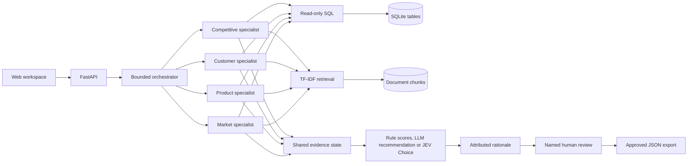

# Market Lens

A runnable MVP of Group 4's **Autonomous Agentic System for Market Intelligence Analysis**, based on the proposal and reference architecture in this folder.

Ask a business question, inspect findings from four specialists, compare candidate actions, and record a human review. The app has a FastAPI backend, SQLite persistence, multilingual document retrieval, broad file conversion, Ollama local inference, and a responsive web interface without a frontend build step.

## Start with Docker

Docker Compose is the supported startup method. Install and start Docker Desktop (macOS/Windows), or Docker Engine with the Compose plugin (Linux). Docker installs Python, the app dependencies, OCR, and Office conversion tools inside the image; you do not need to install Python or create a virtual environment on your computer.

From this project directory, run:

```bash
docker compose up --build -d --wait
```

Open **http://127.0.0.1:8000**. Compose waits for the health check before reporting success. The first build needs internet access to download the image and dependencies. The database is initialized with five clearly labeled synthetic scenarios on first startup. The local analytical baseline needs no API keys, model downloads, or `.env` file.

Uploaded files, datasets, and review history are saved in the named Docker volume `market-lens-data` at `/app/data/market_lens.sqlite3` inside the container. Restarts and image rebuilds preserve them.

```bash
docker compose ps                 # Container and health status
docker compose logs -f market-lens # Follow server logs; Ctrl+C stops following
docker compose restart            # Restart without changing configuration
docker compose down               # Stop and remove the container; preserve data
docker compose up -d --wait
```

If port 8000 is occupied, create `.env` from `.env.example` if you do not already have one, set `PORT=8001`, and run the same startup command. Then open **http://127.0.0.1:8001**. After editing any `.env` settings, run `docker compose up --build -d --wait` to apply them; `restart` alone does not reload environment values.

Do not use `docker compose down -v` unless you intend to erase saved data. The compatibility script `run.sh` invokes the same Docker startup command.

## Try the full workflow

1. Pick a scenario in **Analysis studio**, edit the question if desired, and run it.
2. Inspect **Specialist findings**, **Evidence**, and **Execution trace**. SQL and retrieved passages are visible alongside their source identifiers.
3. Enter a reviewer name. Approve the brief or request a revision with notes.
4. An approved brief can be downloaded as JSON, including sources, queries, scores, trace, and review. Rejected runs can be revised and rerun; the original record remains intact.
5. Upload one or more files in **Knowledge base**. Documents can be scoped to one dataset or shared; tables create datasets. To analyze documents without CSV, choose **Documents only** and select the documents.
6. Run **Evaluation** for five synthetic regression cases. View saved analyses in **Review history**.

Approval is enforced on the server. Drafts cannot be exported through the approved-export endpoint. Review decisions are single-use and durable. Approval records a decision; there is no business-action execution or automatic dissemination.

## Modes and their limits

| Capability | Available immediately | Optional live mode |
| --- | --- | --- |
| Four specialist workers | Deterministic analytical queries and extractive findings, run concurrently | Each LLM specialist generates SQL, searches documents, and produces cited findings |
| Text-to-SQL | Fixed SQL for the documented business schema; preview for generic CSVs | Schema-aware SQL generation with engine-enforced read restrictions |
| Retrieval | Overlapping source chunks, Unicode words/CJK bigrams, TF-IDF cosine similarity | Same scoped local retrieval, with LLM synthesis |
| Decision layer | Inspectable `rules-v1` scores out of 100 | Model recommendation with cited explanation and unranked alternatives, or optional TypeSafe JEV Choice |
| Rationale | Template explanation of the triggered rules | LLM explanation grounded in the shared evidence and selected action |
| Human review | Required for approved export in every mode | Same guardrail |

**Local analytical baseline is the no-model mode. Ollama is a separate local LLM mode.** Its question guides document retrieval; it does not generate SQL or change the numerical rule ranking. Reviewer notes are stored and passed to live agents; local scoring changes only when input data changes. Local documents provide inspectable context but do not change the scoring rules.

**Baseline scores are not probabilities.** They are not normalized, learned, or calibrated. JEV values are preserved separately and labeled as model probabilities and model confidence. Choice probabilities describe support among the six candidate next steps; they are **not** predicted business success rates. JEV's confidence statistic is not a statistical confidence interval. Neither these probabilities nor the local scores have been validated on real business outcomes.

## Ollama: local models without an API key

Start Ollama on the computer running Docker. The UI's **Refresh local models** button discovers installed models; the app does not download a model automatically. This workspace already has `phi3:mini`. To use another model, download its weights with `ollama pull MODEL_NAME`.

1. Open **Knowledge base**, upload files, and check each file's status and extracted content.
2. In **Analysis studio**, select a dataset or choose **Documents only** and check the documents.
3. Expand **Analysis settings**. Select **Ollama · local model**, choose an installed model, and use **Model recommendation**.
4. Enter a question and run the analysis. Review cited passages and original files before approval/export.

Compose defaults to `http://host.docker.internal:11434` so the app can reach host Ollama. The optional `OLLAMA_MODEL` sets the default; users can choose any installed model in the UI. `OLLAMA_TIMEOUT=180` and `OLLAMA_CONTEXT=8192` can be adjusted in `.env`. Apply changed settings with `docker compose up --build -d --wait`.

Ollama requests use `/api/chat` with JSON schemas and response validation. Local specialists run sequentially to avoid competing for model memory. Model recommendations are supported for both document-only and structured-data questions and are not restricted to the six demo actions. They have cited explanations and unranked alternatives, without invented probability scores. Rules and JEV remain separately selectable. Choosing JEV invokes an external API even when specialists use Ollama. Use locally downloaded Ollama weights for offline inference.

For a photo/chart that OCR cannot interpret, select **Ollama vision model** when uploading and choose an installed image-capable model. A text-only model such as `phi3:mini` works for analysis of extracted text but cannot interpret images. Vision conversion is opt-in. Native conversion and OCR make no model calls. Selecting OpenAI vision sends images to the configured OpenAI API. Model-extracted descriptions are labeled separately from raw text and require review.

References: [Ollama structured outputs](https://docs.ollama.com/capabilities/structured-outputs), [chat API](https://docs.ollama.com/api/chat), [model discovery](https://docs.ollama.com/api/tags), [vision inputs](https://docs.ollama.com/capabilities/vision).

## Enable OpenAI agents and JEV

The Docker image already includes the provider SDKs. If `.env` does not exist yet, copy `.env.example` to `.env`. Edit the integrations you want to use:

```dotenv
OPENAI_API_KEY=your-key
OPENAI_MODEL=your-accessible-model-with-structured-outputs
TYPESAFE_API_KEY=your-typesafe-key
JEV_MODEL=jev-latest
```

Apply the settings:

```bash
docker compose up --build -d --wait
```

Both integrations are independently selectable in **Analysis settings**. Keys remain on the server. Selecting live agents sends the selected schema, query results, relevant passages, question, and review notes to OpenAI. Selecting JEV sends the shared analysis state to TypeSafe. These requests may incur provider charges. Local mode makes no provider requests even if keys are configured.

The OpenAI integration uses the Responses API with Pydantic structured output and `store=False`. JEV uses `POST https://api.typesafe.ai/v1/systemone` with typed Choice criteria; returned option sets, finite probabilities, distribution sum, chosen option, and confidence are checked. Provider refusals, failures, malformed decisions, blocked SQL, or invalid evidence references fail the run visibly. No silent fallback pretends to be a live model.

Provider adapters have contract tests with mocked responses. **Real provider calls remain unverified until credentials and an accessible model are configured.** Choose and pin a suitable model/version for your experiments.

Official references consulted for implementation:

- [OpenAI structured outputs](https://developers.openai.com/api/docs/guides/structured-outputs?api-mode=responses)
- [TypeSafe HTTP API](https://docs.typesafe.ai/api)
- [TypeSafe Choice](https://docs.typesafe.ai/primitives/choice)
- [TypeSafe confidence semantics](https://docs.typesafe.ai/confidence)

## Your data

Use **Sample CSV** in the Knowledge base for the supported baseline schema. CSV import supports UTF-8, up to 2 MB, 10,000 rows, and 40 columns. Headers are normalized to lowercase SQL identifiers; duplicate or empty normalized headers and inconsistent row widths are rejected atomically. Finite numeric columns become REAL; other columns remain TEXT. Empty cells become NULL. No assumptions about source currency are made.

For baseline scoring, include these columns:

| Column | Meaning |
| --- | --- |
| `period` | Exactly `previous` or `current`; comparable 30-day windows |
| `units`, `returns` | Sold units and returned units within the period |
| `revenue`, `cost` | Comparable total revenue and cost for each row |
| `customers`, `churned` | Accounts at period start and accounts lost during the period |
| `price`, `competitor_price` | Comparable unit prices |
| `market_growth` | Reported growth as a fraction, e.g. `0.12` for 12% |
| `stock_units` | Closing stock count |
| `lead_time_days` | Supplier lead time in days |

Extra categorical columns, such as `product`, `region`, and `segment`, are allowed. Rows must describe disjoint groups so sums are meaningful. Price, competitor price, market growth, and lead time use simple unweighted means. Stock coverage assumes 30-day periods. Do not mix currencies, periods, duplicate customers, or incompatible products in one dataset. The MVP does not infer these semantics or perform sophisticated cleaning.

Generic CSVs are still stored and previewed. Live agents can query their actual schema. Baseline scoring abstains with **Gather more evidence** when its required metrics are missing or invalid. Null denominators never become invented probabilities.

## File upload and conversion

Use **Knowledge base → Upload your files**. Select multiple files, choose an optional dataset scope and category, and click **Upload & process**. Files are processed sequentially with individual progress/results; one failed file does not discard the others. Original bytes are stored in the persistent SQLite volume, along with extraction metadata and provenance. Duplicates in the same scope/extraction mode reuse the stored file.

| Formats | Extraction and analysis |
| --- | --- |
| PDF | Text extraction by page; pages without usable text use OCR or opt-in vision. Encrypted PDFs require an unlocked copy. |
| DOCX, DOC, RTF, ODT | Paragraphs/tables; legacy DOC uses LibreOffice conversion in Docker. Word references use block positions rather than invented page numbers. |
| PPTX, PPT, ODP | Slide text/tables/notes; legacy PPT uses LibreOffice. Embedded charts/images need image or PDF exports for OCR/vision. |
| CSV, TSV, XLSX, XLSM, XLS, ODS, Parquet | Tables become SQL datasets; Excel imports each sheet. Saved formula results are used; recalculate/save before uploading. Macros are not executed. |
| JSON, JSONL/NDJSON, YAML | Lists of records become tables; other objects become document text. |
| TXT, MD, logs, subtitles, source code and other readable text | Text extraction, including Unicode and common encodings. |
| HTML, XML, SVG | Readable text; scripts are removed from HTML and XML external entities are blocked. |
| EML, MBOX | Message headers/body and supported attachments. |
| EPUB | Chapters in spine order. |
| PNG, JPEG, WEBP, GIF, BMP, TIFF, HEIC/HEIF | Local Tesseract OCR or opt-in Ollama/OpenAI vision. Multi-frame images are bounded. |
| ZIP, TAR, TAR.GZ/TGZ, GZ | Supported members are processed without extracting archive paths to disk. Nested archives and expanded sizes are bounded. |
| MP3, WAV, M4A, FLAC, OGG, AAC, MP4, MOV, MKV, WEBM, AVI | Optional local Whisper speech transcription. Video visuals are not interpreted. |

Limits: 25 MB per file, 64 files per browser batch/archive, 200 PDF pages, 2 million extracted characters per file, and 10,000 rows/40 columns per SQL table. Large files should be split. Archive expansion is capped at 100 MB and nesting at two levels. Unsupported binaries, RAR/7z and encrypted files return actionable errors; exporting to PDF/DOCX/CSV/text is the fallback. This is broad format support, not a guarantee that every proprietary format or layout is understood.

Manual document text supports up to 2 million characters within the request byte limit. Source URLs are attribution metadata and are not fetched. PDF pages, slide numbers, sheet/table names, Word block positions, archive members and speech timestamps remain attached to retrieved chunks. **Download original** is available in document previews and evidence. Categories describe documents; dataset/document selection controls retrieval scope. In document-only mode, only explicitly selected documents are searched. With a dataset, associated/shared documents are searched unless a narrower selection is supplied.

Retrieval is lexical TF-IDF with Unicode tokens and CJK bigrams, not semantic embeddings or an exhaustive review of all uploaded pages. A broad document-only question with no keyword matches uses previews of selected documents, marked in evidence. OCR, tables and model vision can misread content; check extraction warnings and originals. No remote vector database, automated news scraper or Kaggle download is included.

## Optional audio/video transcription

To enable local speech transcription, create `.env` from `.env.example` if needed and set:

```dotenv
INSTALL_MEDIA=1
WHISPER_MODEL=tiny
```

Build and start with the same command:

```bash
docker compose up --build -d --wait
```

Keep these settings in `.env` for subsequent builds and starts. Use `tiny`, `base`, or a compatible local model directory accessible inside the container. The first transcription downloads model weights if given a model name; cached weights live in the persistent data volume. Offline first use requires preinstalled weights. Recordings are limited to 30 minutes and the same 25 MB file limit. The default Docker image leaves this optional dependency out.


## Architecture



- `app/database.py`: CSV ingest, schema inference, datasets, chunks, read-only analytics, run/review persistence.
- `app/retrieval.py`: overlapping word chunks are stored at ingest; TF-IDF vectors are computed over the scoped corpus at query time.
- `app/engine.py`: specialist execution, shared state, metrics, explicit scoring rules, measured trace, regression scenarios.
- `app/ingestion.py`: bounded format routing, native parsers, OCR, Office conversion, optional vision/transcription and original-file ingestion.
- `app/providers.py`: OpenAI, Ollama and JEV adapters, discovery and response validation.
- `app/main.py`: API routes, bounded job execution, input limits, local-origin boundary, review/export guardrails.
- `app/static/`: responsive interface, no CDN assets or Node dependencies.

SQL runs on a read-only SQLite connection. An SQLite authorizer permits reads only from the selected data table, denies writes and metadata access, and allows a small set of analytical functions. Queries have a two-second execution budget and 200-row return cap. Document text is treated as untrusted evidence in live prompts. Citation validation verifies reference existence, not semantic entailment; a reviewer must check the latter.

## Tests and evaluation

Run the synthetic benchmark using **Evaluation** in the web interface. For development, run the unit tests inside Docker from this project directory; the test directory is mounted read-only and no host Python installation is needed:

```bash
docker compose build
docker compose run --rm --no-deps --volume "./tests:/tests:ro" market-lens python -m unittest discover -s /tests -v
```

The test suite includes real PDF/DOCX/PPTX/XLSX/Parquet/EPUB/ODT/email/archive/OCR fixtures, document-only analysis, Unicode retrieval, original downloads, Ollama schemas and model selection. It also covers the five scenario outcomes, changed-data behavior, generic schemas, missing metrics, CSV validation, SQL isolation and row limits, retrieval scoping, chunk provenance, provider contracts/failures, immutable reviews, export gating, revision lineage, import/preview, persistence, and request boundaries. Tests use temporary databases and no API credentials.

The five demo cases are **synthetic fixtures designed together with the rules**, not real-world validation or independent holdout data. The UI reports actual completion, elapsed time, tool-call count, expected-action agreement, and reference coverage. API cost is $0 for local runs and unknown for live runs; live token counts are retained when available. Text-to-SQL execution accuracy, source entailment, retrieval recall, outcome calibration, and human agreement require separately labeled evaluation sets. Do not report fixture pass rate as real-world model accuracy in your project.

## Container details

The image includes Tesseract (English, Simplified and Traditional Chinese) and LibreOffice for legacy Word/PowerPoint conversion. The container runs as a non-root user with a read-only application filesystem, a writable temporary directory, and a named volume for SQLite. Its health check probes `/api/health`. Compose publishes only on the local loopback interface. Unrelated workspace files, credentials, local databases, and the supplied proposal/image are excluded from the image; only app code and dependencies are copied.

Compose injects the selected `.env` settings at runtime; `.env` is never copied into the image. The database location is fixed by `compose.yaml` inside the persistent volume. To build an image without starting a container, use `docker compose build`.

Run one app container with one server process: jobs run in-process and are not coordinated across multiple replicas or Uvicorn workers.

The MVP is a **single-user local application**, without authentication or verified reviewer identity. Names in reviews are self-reported audit labels. Before a public or shared deployment, add authentication, authorization, a durable job queue, rate limiting, backups, and a tested multi-user database strategy. PostgreSQL, hosted vector search, MLflow, and cloud hosting from the reference architecture are extension points, not implemented services.

## API

The machine-readable schema is served at `/openapi.json`. The main routes are:

| Method / route | Purpose |
| --- | --- |
| `GET /api/config`, `/api/health` | Capabilities and health; never secret values |
| `GET /api/sources` | Dataset and document inventory |
| `POST /api/datasets` | JSON `{name, content}` containing CSV text |
| `POST /api/documents` | JSON `{title, content, source?, dataset_id?}` |
| `POST /api/uploads` | Multipart `file`, optional `dataset_id`, `category`, `vision_provider`, `vision_model` |
| `GET /api/files/{id}` | Download original uploaded bytes |
| `GET /api/models/ollama` | Local Ollama connection status and installed model names |
| `POST /api/query` | Read-only SQL against one selected dataset |
| `POST /api/analyses` | Start a job; optional dataset, explicit document IDs, agent/decision modes and Ollama model |
| `GET /api/analyses/{id}` | Poll status, evidence, and execution trace |
| `POST /api/analyses/{id}/review` | Named approval/rejection; notes required to reject |
| `GET /api/analyses/{id}/export` | Approved brief with full provenance |
| `POST /api/benchmarks` | Run synthetic local regression suite |

Job states: `queued → running → pending_review → approved/rejected`, or `failed`. Pending jobs interrupted by a server restart are marked failed explicitly; existing completed results and review history are preserved.
