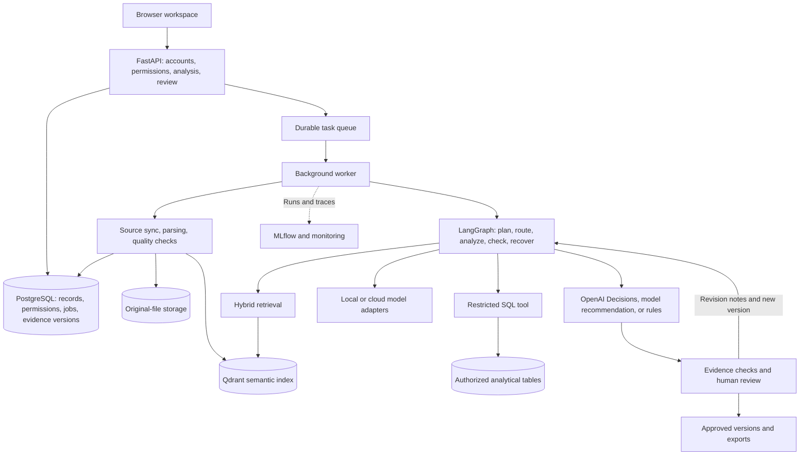

# Market Lens refactor plan

Date: 2026-10-24. This document preserves the architectural proposal and records the later decision-provider and local-model-profile changes. The small-team implementation now exists. For final technology choices, test evidence, and unverified limits, see the [acceptance record](ACCEPTANCE.md); for current setup, see the [README](../README.md). Proposed capabilities below are not automatically claims of completed implementation.

Confirmed requirements: the first release serves a small internal team and supports local and cloud deployment, local models, and cloud models. The goal is useful market-analysis software that can be maintained and upgraded. The original proposal named TypeSafe JEV as its decision provider. The current design replaces it with OpenAI Decisions using the existing OpenAI credential.

## 1. Product goals and first-release scope

Build a market-analysis workspace whose modules are useful independently: source management, data questions, combined analysis, review and reporting, and recurring review. Complete one analysis cycle with real business data and documents before expanding industries and sources.

The proposed first use case is sales and competitive analysis. Sales tables, competitor information, and internal policies support questions about revenue changes, pricing, churn, returns, and supply risk. Phase 0 should establish the actual industry and metric definitions from real sources.

| User task | Intended first-release behavior |
| --- | --- |
| Prepare sources | Upload files or connect specific sources; show versions, dates, parsed content, and failures; support retries and field-mapping corrections. |
| Ask about data | Return actual tables or charts, metric definitions, and inspectable SQL for natural-language questions. |
| Search documents | Search only authorized material; include source locations, original files, and source dates. |
| Compare actions | Select relevant specialist roles and combine tables with documents into recommendations, alternatives, evidence gaps, and uncertainty. |
| Review reports | Inspect evidence, approve or reject, create a new version after changes, and export PDF, HTML, and JSON. |
| Continue using the workspace | Save analysis templates; update sources and generate pending-review reports on user-configured schedules; compare changes. |

Roles are administrator, analyst, reviewer, and viewer. Workspace and project boundaries must be enforced on the server, even if the first deployment contains only one team. Hiding a button is not authorization.

External multi-customer SaaS, billing, and complex enterprise SSO are later work. Automatically changing prices, placing orders, and other business actions are out of scope; the workflow ends with a reviewed report.

## 2. Proposed architecture

Use a modular monolith: one business codebase with separate API and worker processes, and supporting services started with Docker Compose. Define module boundaries before considering further service separation in response to measured bottlenecks.

PostgreSQL is authoritative for business state. Qdrant is a rebuildable retrieval index. The original storage proposal used a dedicated local volume or cloud object storage, with metadata and checksums in PostgreSQL; the implemented release instead stores original bytes in PostgreSQL. Analytical tables are separate from application internals, and models can access only authorized data through restricted tools.

Task creation and delivery need recoverable transactional semantics so a committed job cannot disappear between the database and queue. Queue messages should contain task identifiers rather than entire sources. Workers need locks or leases, heartbeats, retry bounds, and idempotency keys. LangGraph checkpoints persist in PostgreSQL. Human review releases the worker, and a revision creates a new execution. Checkpoints alone cannot ensure exactly-once external API calls; uncertain and repeated requests require explicit handling.

## 3. Open-source reuse and technology selection

The following candidates were screened using official repositories and documentation. Compatibility, resource usage, and maintenance costs still require project-specific validation. An actively maintained dependency does not by itself make the integrated application reliable.

| Capability | Candidate reuse | Integration boundary |
| --- | --- | --- |
| Web foundation | [Full Stack FastAPI Template](https://github.com/fastapi/full-stack-fastapi-template) | Reuse organizational patterns for FastAPI, React, TypeScript, PostgreSQL, authentication, testing, and CI. Port modules deliberately; implement workspace permissions and review rules within this application. |
| Agent orchestration | [LangGraph](https://github.com/langchain-ai/langgraph), [persistence documentation](https://docs.langchain.com/oss/python/langgraph/persistence) | Conditional routing, bounded tool loops, checkpoints, and resumable human review. Use one primary orchestration framework. |
| Document parsing | [Docling](https://github.com/docling-project/docling) | Candidate for PDF layout, tables, OCR, and Office formats. Preserve verified format adapters and migrate only when sample quality justifies it. The current release retains those adapters. |
| Vector and hybrid search | [Qdrant](https://github.com/qdrant/qdrant), [hybrid query documentation](https://qdrant.tech/documentation/search/hybrid-queries/) | Store semantic vectors and provenance. Enforce permission filters server-side and recheck returned sources. The current release combines keyword results with vectors using rank fusion. |
| SQL structure checks | [SQLGlot](https://github.com/tobymao/sqlglot) | Parse and validate tables, columns, and statement structure. Keep database read-only roles, timeouts, and result bounds; parsing alone proves neither correctness nor authorization. |
| Background tasks | [Celery](https://docs.celeryq.dev/en/stable/userguide/tasks.html) + [RabbitMQ](https://docs.celeryq.dev/en/stable/getting-started/backends-and-brokers/index.html) | Originally proposed for imports, indexes, analyses, and schedules. The current implementation uses a PostgreSQL task table and independent worker to reduce deployment complexity. |
| Tracking and evaluation | [MLflow](https://mlflow.org/docs/latest/genai/index.html) | Record models, prompt versions, tool calls, timings, usage, and evaluations. Define business metrics explicitly and redact or omit sensitive source content. |
| Kaggle import | [kagglehub](https://github.com/Kaggle/kagglehub) | Import only user-specified datasets and versions. Preserve provenance; users provide credentials where access requires them. |
| News and web sources | [Trafilatura](https://github.com/adbar/trafilatura) | Prefer specified RSS feeds, authorized APIs, and allowed pages. Preserve content, source, event/publication/fetch dates, and versions; support deduplication. |
| Decision provider | [OpenAI Decisions](https://developers.openai.com/api/docs/guides/decisions) | Replace the original TypeSafe JEV adapter. Preserve model, candidates, choice probabilities, confidence, usage, and explicit failure states. Use a separate decision-model and pricing configuration. |

The frontend proposal uses React, TypeScript, and Vite, drawing on the template's component organization and API-client patterns. The backend keeps FastAPI. SQLAlchemy/SQLModel and Alembic were originally proposed; the delivered release retains its dual-database adapter and explicit migrations instead.

Pin versions that pass compatibility tests and retain lockfiles. Do not track a dependency's latest branch in production. Release histories inform maintenance review: [LangGraph](https://github.com/langchain-ai/langgraph/releases), [Qdrant](https://github.com/qdrant/qdrant/releases), and [Docling](https://github.com/docling-project/docling/releases).

[Dify](https://github.com/langgenius/dify) and [RAGFlow](https://github.com/infiniflow/ragflow) were also considered as whole-platform alternatives. They can support prototypes or a separate knowledge service. This application additionally needs precise metrics, restricted SQL, independent decision selection, versioned evidence, and traceable review. Reusing components with a dedicated business layer avoids maintaining two complete identity, job, and knowledge systems.

Dify's license has additional conditions concerning multi-tenant use and frontend branding; assess the exact deployment against the [license](https://github.com/langgenius/dify/blob/main/LICENSE) if adopting it. Record licenses and third-party notices for pinned versions, and review model-weight licenses separately.

## 4. Core capabilities

### 4.1 Data ingestion and definitions

Start with a data dictionary: column meanings, units, currencies, timezones, reporting periods, keys, relationships, and metric formulas. Preview quality and expose missing values, duplicate rows, outliers, and field mappings. Do not silently mix currencies, duplicate customers, or incompatible periods. Prioritize CSV/XLSX, PDF/DOCX, and a read-only PostgreSQL source, retaining other formats within their tested limits.

Give connectors common interfaces for connection checks, resource listing, synchronization, incremental cursors, retry, and deletion. Kaggle and news use the same ingestion queue. Preserve event and publication dates and flag stale content. A failed dynamic-page fetch must not be interpreted as evidence that no relevant news exists.

### 4.2 Document retrieval

Chunk by useful headings, paragraphs, and table boundaries while preserving source versions and page or block locations. Evaluate multilingual embeddings and any proposed reranker with representative sources. Combine keyword and semantic recall. Report indexing status explicitly, update or exclude stale indexes after changes, and cite fixed evidence versions. Model changes create separate indexes; never mix vectors from different embedding versions.

The current release uses rank fusion and does not claim a trained cross-encoder. Logical exclusion of obsolete vectors and physical collection cleanup are separate concerns.

### 4.3 Data questions

Select relevant tables and metric definitions, generate a SQL draft, validate it, and execute through a read-only interface. Permit bounded repair of syntax or column errors. Clarify ambiguous metrics or state assumptions. Tables and charts must come from actual query results; perform arithmetic in SQL or deterministic code. Authorized joins should retain query text, parameters, data versions, and result snapshots.

### 4.4 Specialists and routing

The planner returns a structured decomposition with roles, sources, tools, and stopping conditions. Keep competitive, customer, product, and market specialists. Use only the necessary roles for simple questions; coordinate several for complex questions. Route to SQL, retrieval, or both, and stop with explicit evidence gaps when sources are insufficient. Follow-up and repair must be bounded.

Shared state contains objectives, versioned references, tool results, facts, inferences, conflicts, gaps, candidate actions, and budgets. Aggregate with structured fields and evidence checks. Bound calls, elapsed time, and tokens, and report known costs. Exhausted budgets must end in an explainable state.

### 4.5 Decision selection

Business templates define comparable candidate actions, constraints, and evaluation criteria. Users may supply candidates; decisions are not restricted to six demo actions. Send the evidence and constraints to an OpenAI Decisions choice question using `OPENAI_DECISION_MODEL=gpt-6-luna` and the existing `OPENAI_API_KEY`. Preserve each option's probability and the returned confidence without relabeling either as business success or a statistical confidence interval. Follow the [official API contract](https://developers.openai.com/api/docs/guides/decisions).

Maintain three distinguishable adapters: OpenAI Decisions, ordinary model recommendation, and the rule baseline. Configuration or provider failures must be explicit. A user-selected engine change creates a new analysis version. Validate real provider access and application behavior, including data-only, document-only, insufficient-evidence, timeout, rate-limit, refusal, and malformed-response paths. Separate real-service checks from simulated error tests.

For compatibility, legacy `jev` request values normalize to `openai_decisions` when executing a new run, revision, schedule, or evaluation. Preserve completed result payloads and approval hashes with their original provider attribution. Decisions uses separate pricing settings; the Responses model's price must not be applied to it.

### 4.6 Explanation, review, and export

Distinguish direct facts, calculations, and inference. Important claims link to SQL results or original passages. Validate reference existence and use automatic evaluation plus human samples to assess support; automated checks cannot prove every conclusion. Bind approvals to a specific report, source versions, and authenticated reviewer. Changed results need new approval. Rejection notes inform a new run, while approved results stay immutable. PDF, HTML, and JSON exports use the same report data and include provenance and review records.

### 4.7 Recovery, configuration, and operations

Expose queued, parsing, indexing, analyzing, pending-review, failed, and canceled states with useful recovery actions. Add connection checks, model capability checks, quotas, run records, backups, migration, and diagnostics. Use reviewed server-side adapters and common interfaces for integrations. Add MCP only for a concrete integration need; do not permit arbitrary code installation into production.

## 5. Local and cloud behavior

| Deployment / inference | Expected behavior |
| --- | --- |
| Local deployment and local inference | Preinstall model, embedding, and parsing dependencies. Local-only mode blocks external inference, cloud decisions, and online synchronization. Cached material remains usable. |
| Local deployment and cloud inference | Files remain in local storage, but selected evidence is sent to the chosen provider. Show the actual engine and data-transfer scope. |
| Cloud deployment | Use the same code and data model with HTTPS, centralized credentials, and tested backups. The current release stores originals in PostgreSQL; object storage is a later extension. |

Running the server locally does not guarantee that data stays local. `LOCAL_ONLY=true` must block external analysis, embeddings, vision, and OpenAI Decisions, with network-call tests covering the boundary. OpenAI Decisions depends on an external API and is not an offline capability.

One server is appropriate for the first small-team deployment. Authentication, session management, and application-level authorization are required. OIDC can later connect an existing organization identity system, but cannot replace data authorization. External SaaS requires additional tenant, billing, and operational design.

### 5.1 Local model roles and operating modes

The local profile extension targets the owner's Apple M4 with 16 GB unified memory. Downloaded models are assigned distinct jobs; they need not remain loaded simultaneously. The existing four business specialists remain reasoning roles and do not each require a separate set of model weights.

| Mode or role | Model assignment | Routing behavior |
| --- | --- | --- |
| Local Fast | `OLLAMA_FAST_MODEL`, initially `qwen3.5:4b-q4_K_M` | Use the fast model for all text stages |
| Local Quality | `OLLAMA_QUALITY_MODEL`, initially `qwen3.5:9b-q4_K_M` | Use the quality model for all text stages |
| Local Auto | Fast planner, then fast or quality analysis | Apply a deterministic policy to source and plan structure; retain the reason and actual model usage |
| Image understanding | `OLLAMA_VISION_MODEL`, initially Qwen3.5 4B | Use only when image interpretation is selected; preserve original files and existing OCR/parsers |
| Document embeddings | Existing Ollama `bge-m3` | Retrieve relevant passages with Qdrant and keyword fusion; separate from generation |
| Custom local | Explicitly selected installed model | Preserve prior local behavior and deliberate combinations with cloud decisions |

The profile field defaults to custom for backward compatibility. A named local profile requires local analysis, local model recommendation, and local or lexical retrieval. It must not invoke a cloud fallback after failure. The deployment-wide `LOCAL_ONLY` setting remains the stronger boundary that also disables separately triggered cloud vision and online source synchronization.

Automatic selection must be explainable from the actual workload rather than a model's confidence score. The initial policy selects quality analysis for multiple selected tables, mixed SQL/document work, multiple specialist tasks, reviewer instructions, or explicit candidate comparison, and escalates if another evidence round is requested. A single specialist using one evidence route can retain the fast model. These structural rules do not establish that a result is correct or a task is intrinsically easy.

Record effective profile configuration, installed model digests, and thinking/context/output controls with each new run, preserve routing state through checkpoints, include the effective model in cached-response keys, and record the actual model for each stage. Reject a queued run when its recorded weights or generation controls have changed. A revision or rerun is a new execution; existing approved payloads and hashes stay unchanged. Missing models and incompatible configuration must fail explicitly. Named-profile evaluations must use a local judge or no model judge.

Keep one worker and modest context budgets on the 16 GB target. Validate structured output, thinking controls, model-loading behavior, and generation limits before changing production defaults. Evaluate Fast, Quality, and both Auto paths with SQL, RAG, mixed-source, insufficient-evidence, and image cases. Compare correctness, supported citations, refusal/abstention behavior, latency, and memory pressure against the previously verified Qwen2.5:7b model. Separate successful integration from claims about business accuracy or an automatic quality advantage for the larger model.

## 6. Migration approach

Keep a runnable baseline and migrate modules on an isolated branch. Continue using the five synthetic scenarios for regression without counting them as an independent quality set.

| Existing module | Refactor direction |
| --- | --- |
| `app/main.py` | Separate API, authorization, task services, and dependencies; move long-running execution out of API processes. |
| `app/database.py` | Separate data access, ingestion, read-only queries, and migration responsibilities. |
| `app/engine.py` | Retain deterministic metrics and rule tools; move orchestration into LangGraph. |
| `app/providers.py` | Give model and decision adapters common capabilities, usage, timeout, and error contracts. |
| `app/retrieval.py` | Retain TF-IDF as a comparison baseline; add hybrid search and index versions. |
| `app/ingestion.py` | Separate format parsers from source connectors and run parsing in bounded workers. |
| `app/static/` | Migrate the workspace, knowledge base, history, and evaluation workflows to React. |
| `tests/` | Preserve regressions and add real database/index integration, end-to-end workflows, and independent quality evaluation. |

Proposed domain entities include Workspace, Membership, Project, Source, SourceVersion, Dataset, MetricDefinition, Document, Chunk, AnalysisRun, Evidence, ReportVersion, Review, Schedule, Usage, and AuditEvent. These are design responsibilities, not a claim that every entity has a separate implemented table.

Rehearse SQLite migration on a copy. Back up sources and files, migrate data and review history, verify counts, hashes, references, and approval relationships, then rebuild indexes. Retain old export readability and verify recovery before switching. Database rollback requires compatible migration or a backup restore; reverting only the image is insufficient.

## 7. Delivery phases

| Phase | Work | Acceptance outcome |
| --- | --- | --- |
| 0: Requirements and technical validation | Select a real workflow, define metrics, create independent questions, verify parsers/retrieval/models/Decisions access, and establish machine and budget limits. | Real sources, human-checked answers and citations, compatibility records, and reproducible timing/cost baselines. Mark unavailable services unverified. |
| 1: Reliable foundation | Accounts, workspace authorization, PostgreSQL migration, original storage, durable tasks, versioning, audit, React, and CI. | Users can sign in and manage sources; restarted jobs have explicit outcomes; history migrates; isolation tests pass. |
| 2: Independent knowledge workspace | Parsing previews, chunking, embeddings, hybrid search, references, and specified Kaggle/RSS sources. | Real-source retrieval is evaluated; updates, deletion, and retries cannot expose unauthorized or stale evidence. |
| 3: Independent data analysis | Dictionaries, natural-language SQL, bounded repair, read-only execution, result tables, and charts. | Compare held-out questions against human query results; handle joins, missing fields, metric ambiguity, and unauthorized access explicitly. |
| 4: Complete decision workflow | LangGraph planning and routing, specialists, shared evidence, conflict checks, candidates, and real OpenAI Decisions integration. | Correct SQL/RAG/hybrid routes, bounded follow-up, provider failure recovery, traceable recommendations, and reviewable live-service records. |
| 5: Review and continued use | Version-bound review, reruns after rejection, exports, and user-configured recurring work. | Duplicate requests do not duplicate approvals; modifications require review; exports match approved versions; schedules avoid duplicate reports. |
| 6: Pilot and release | Independent quality evaluation, concurrency and long-run checks, failure injection, backup/restore, upgrade rehearsal, and team trials. | Agreed metrics and operational requirements are met; users repeatedly complete tasks; installation, upgrade, recovery, diagnosis, and release records exist. |

Authorization, tracking, tests, and documentation begin in phase 1 and continue throughout. Each phase should deliver demonstrable standalone value. Complete a real business path before broadening formats, models, and connectors.

Estimate schedules and costs only after phase 0 establishes source volume, model speed, machine resources, team capacity, and service access. Unverified delivery dates and monthly costs are not commitments.

## 8. Maturity criteria

The following is the proposed acceptance framework, not a claim that the current release meets every maturity target. Freeze numeric thresholds after phase 0 and report sample size, business scope, model version, and hardware.

| Metric or requirement | Verification |
| --- | --- |
| Tool-call rate | Evaluate correct routing on labeled SQL, RAG, hybrid, no-tool, and missing-source tasks; report raw call count separately. |
| Text-to-SQL accuracy | Compare generated query results against gold results on fixed data, covering aggregation, joins, nulls, and time windows. Successful execution alone is insufficient. |
| Retrieval quality | Label relevant passages across languages, tables, scans, and multi-document questions; measure Recall@k and answer faithfulness separately. |
| Attribution coverage | Distinguish existing-reference rate, key-claim citation coverage, and human-verified factual support. |
| Task completion | Measure completion across eligible jobs and report failure reasons; keep approval separate. |
| Latency and cost | Measure queue, parsing, retrieval, model, and total latency, including P50/P95; associate usage with price versions and separate local resource costs from API charges. |
| Human approval rate | Measure approvals among reports with completed reviews, distinguishing first drafts and revisions and excluding pending reviews. |
| User testing | Ask actual team members to perform typical tasks; record success, time, edits, satisfaction, and repeat use. |
| Authorization and stability | Deny cross-project and cross-role access in the test scope; verify read-only queries, redaction, parsing bounds, cancellation, timeouts, and recovery. |
| Release and recovery | Rehearse clean installation, upgrades, restore, index rebuild, and rollback; agree on recovery time and tolerable data loss. |

Build an initial set of roughly 100–200 questions from real needs, split into development and frozen holdout sets. This is a starting point, not proof of universal coverage. Add failures and rare cases to development data and update the holdout set through a controlled process. Humans verify key answers; model judges are supplementary.

Changes to models, prompts, parsers, retrieval, or dependencies require relevant regression and quality checks. CI provider mocks verify contracts; separate live-service checks establish dated compatibility; load and recovery exercises establish operational behavior. Report these categories separately.

## 9. Initial work package and remaining inputs

1. Preserve the baseline and tests; document migration scope for sources and history.
2. Use real sales data, competitor material, and internal policies to define ten essential questions and correct answers.
3. Verify minimal parser, Qdrant, LangGraph, and OpenAI Decisions integrations; record resources, latency, and failures.
4. Define the data dictionary, permission matrix, interfaces, migration design, and pinned dependencies.
5. Deliver the complete sign-in, upload, question, evidence, and review workflow, then expand scope.

The industry, real sources, source volume, concurrent analysis demand, model/hardware capacity, cloud budget, team staffing, and rollout date still determine final capacity and scheduling. Real OpenAI Decisions account access has now been checked directly; application-level acceptance remains separately recorded in [ACCEPTANCE.md](ACCEPTANCE.md).
